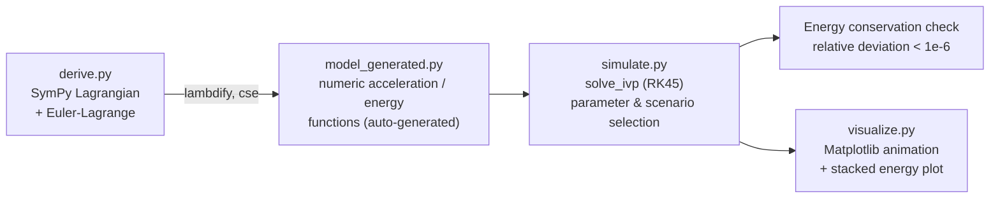

# Spring-Driven Double Pendulum — Autoparametric Resonance

[](LICENSE)
[](https://www.python.org/)


Symbolic derivation and numerical simulation of a mechanical system in which
a **spring-driven Atwood machine** drives a **double pendulum** suspended
from it. When the spring's oscillation frequency is tuned to roughly twice
the frequency of the pendulum's "slow" normal mode, the system exhibits
**autoparametric resonance** (a 2:1 internal resonance): energy is pumped
periodically from the spring mode into the pendulum mode, and the system
drifts into a **chaotic** regime.

> Türkçe sürüm: [README.md](README.md)

## The System

```
      ___ pulley (O)
     |   \
     |    \  r = l1 + x   (variable-length upper link)
     M     m1
     |       \  l2
   spring     m2
     |
  (wall)
```

- Mass **M** rests on top of a vertical spring with constant **k**.
- An inextensible rope runs from the top of M, over a fixed pulley, and
  continues as the double pendulum's upper link (down to m1). Since the
  total rope length is fixed, when M rises by **x**, the pendulum-side
  upper link lengthens by the same amount: `r = l1 + x`.
- The lower link (**l2**, m1→m2) is rigid; **th1**, **th2** are angles
  measured from the vertical.
- Generalized coordinates: **q = (x, th1, th2)**.

The spring's small-oscillation frequency is `ω_spring = sqrt(k / (M+m1+m2))`,
and `ω_slow` is the frequency of the double pendulum's slow normal mode.
When `ω_spring / ω_slow ≈ 2`, the system enters autoparametric resonance.

## Architecture



`derive.py` symbolically builds the system's Lagrangian (`L = T - V`),
derives the Euler-Lagrange equations, computes the closed-form
`qdd = A⁻¹ b` solution (via adjugate/determinant, avoiding numeric linear
algebra), and writes the Python source generated by
`sympy.lambdify(..., cse=True)` to `model_generated.py`. `simulate.py`
generates this file once if it doesn't exist and imports it directly on
every later run — no re-derivation is needed.

## Energy Conservation Check

In a conservative system, total mechanical energy `E = K + U_spring + U_g`
must stay constant. `simulate.py` runs `solve_ivp` (RK45) starting at
`rtol = atol = 1e-10`; if the relative energy deviation
(`|E(t) - E0| / (E0 - E_equilibrium)`) exceeds the **1e-6** target, it
automatically tightens the tolerances and re-solves. This is a practical
check that the integrator produces physically consistent results.

| Non-resonant case | Autoparametric resonance |
|:---:|:---:|
|  |  |

The top panel shows `E(t) - E0` (Joules); the bottom panel shows the
relative deviation on a log scale with the 1e-6 target line. In both
scenarios the deviation stays below the target. Reproduce these plots with:

```bash
python simulate.py --case nonresonant --plot
python simulate.py --case resonant --plot
```

### Animation

No animation file is checked into the repo — generate one with
`visualize.py`:

```bash
python visualize.py --case resonant --save anim.gif
```

## Code Layout

| File | Description |
|---|---|
| `derive.py` | SymPy Lagrangian derivation, Euler-Lagrange equations, closed-form acceleration solve; generates `model_generated.py`. |
| `model_generated.py` | **Auto-generated** (do not edit by hand). Contains `accel`, `mass_matrix`, `kinetic`, `elastic`, `gravity`, `positions`. |
| `simulate.py` | Scenario/parameter selection (`nonresonant` / `resonant`), normal-mode analysis (generalized eigenvalue problem via `eigh`), `solve_ivp` integration, energy & rope-tension report, energy plot. |
| `visualize.py` | Dark-themed Matplotlib animation: physical system + fading trail of m2 (top panel), stacked energy-area plot (bottom panel). Supports PNG frame export or GIF/MP4 output. |

## Setup and Usage

```bash
pip install -r requirements.txt

# 1) (optional) symbolically derive the model — simulate.py does this automatically if missing
python derive.py

# 2) solve the scenario, get an energy/tension report, save the plot
python simulate.py --case resonant --plot
python simulate.py --case nonresonant --plot

# 3) watch the animation or save it to a file
python visualize.py --case resonant
python visualize.py --case resonant --save anim.gif
```

Requirements: `sympy`, `numpy`, `scipy`, `matplotlib` (see `requirements.txt`).
Pillow (bundled with matplotlib) is needed for `.gif` output; `ffmpeg` must
be installed on the system for `.mp4` output.

## References

| Source | Topic |
|---|---|
| [SymPy Documentation](https://docs.sympy.org/) | Symbolic Lagrangian derivation, `lambdify` |
| [SciPy `solve_ivp`](https://docs.scipy.org/doc/scipy/reference/generated/scipy.integrate.solve_ivp.html) | Numerical integration (RK45) |
| [SciPy `eigh`](https://docs.scipy.org/doc/scipy/reference/generated/scipy.linalg.eigh.html) | Generalized eigenvalue problem (normal modes) |
| Goldstein, Poole & Safko, *Classical Mechanics* | Lagrangian mechanics, Euler-Lagrange equations |
| Nayfeh & Mook, *Nonlinear Oscillations* | Autoparametric resonance, 2:1 internal resonance |
| [Matplotlib Animation API](https://matplotlib.org/stable/api/animation_api.html) | `FuncAnimation`, animation output |

## Attribution

This project was inspired by a "Spring-Driven Double Pendulum" post from the
Instagram account **[@veer.alak.sim](https://www.instagram.com/veer.alak.sim/)**
and content from **[@equationsinmotion](https://www.instagram.com/equationsinmotion/)**,
but was derived and coded independently from scratch.

## License

[MIT](LICENSE) © 2026 Musa Buğra Demir
