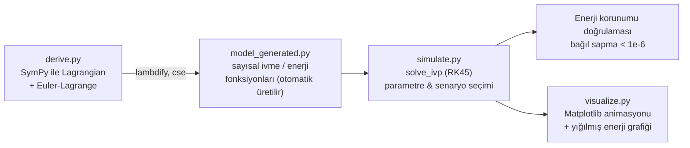
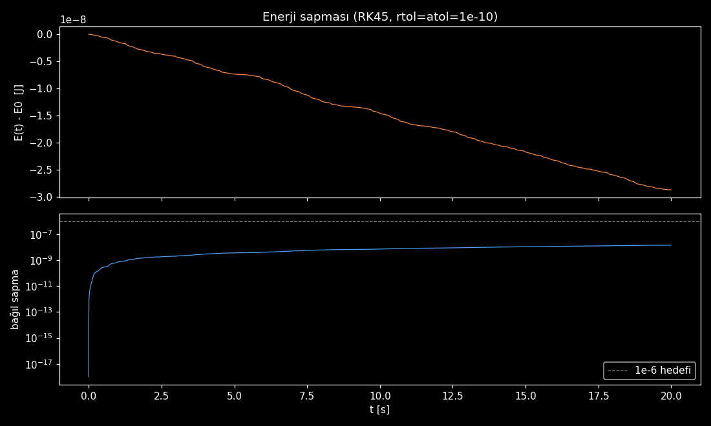
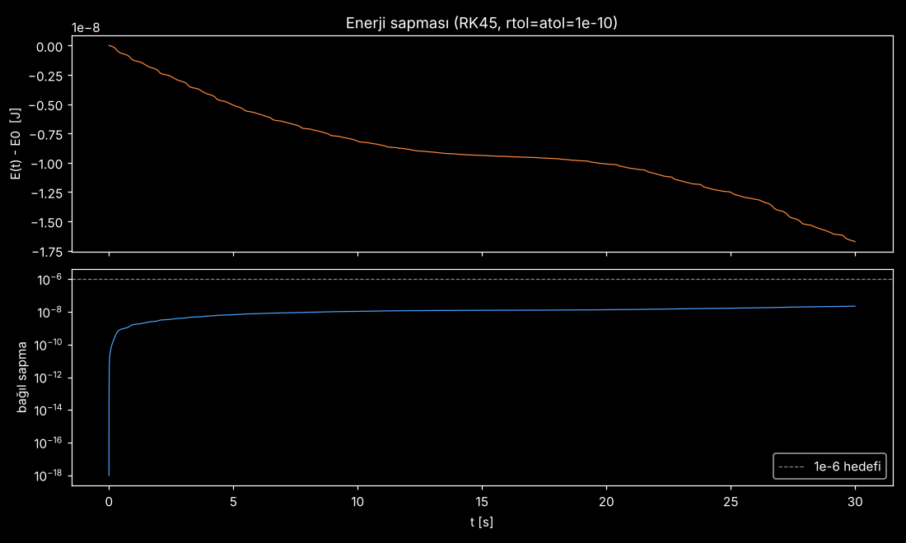

# Yay Tahrikli Çift Sarkaç — Otoparametrik Rezonans

[](LICENSE)
[](https://www.python.org/)


Bir **yay-Atwood makinesi**nin, ucuna bağlı bir **çift sarkacı** tahrik ettiği
mekanik sistemin sembolik türetme ve sayısal simülasyonu. Yay salınım
frekansı sarkacın "yavaş" normal modunun frekansının yaklaşık iki katına
ayarlandığında sistem **otoparametrik rezonans** (2:1 iç rezonans) gösterir:
enerji yay modundan sarkaç moduna periyodik olarak pompalanır ve sistem
giderek **kaotik** bir rejime geçer.

> English version: [README.en.md](README.en.md)

## Sistem

```
      ___ makara (O)
     |   \
     |    \  r = l1 + x   (değişken uzunluklu üst link)
     M     m1
     |       \  l2
   yay        m2
     |
  (duvar)
```

- Kütle **M**, sabit **k** katsayılı düşey bir yayın üstünde durur.
- Esnemez bir ip, M'nin üstünden sabit bir makaraya, oradan da çift sarkacın
  üst linkine (m1'e kadar) uzanır. İp boyu sabit olduğundan M **x** kadar
  yukarı çıkınca sarkaç tarafındaki üst link **x** kadar uzar: `r = l1 + x`.
- Alt link (**l2**, m1→m2) rijittir; **th1**, **th2** düşeyden ölçülen açılardır.
- Genelleştirilmiş koordinatlar: **q = (x, th1, th2)**.

Yayın küçük salınım frekansı `ω_yay = sqrt(k / (M+m1+m2))`, çift sarkacın
yavaş normal modunun frekansı `ω_yavaş`dır. Oran `ω_yay / ω_yavaş ≈ 2`
olduğunda sistem otoparametrik rezonansa girer.

## Mimari



`derive.py`, sistemin Lagrangian'ını (`L = T - V`) sembolik olarak kurar,
Euler-Lagrange denklemlerini çıkarır, `qdd = A⁻¹ b` kapalı formunu
(adjugate/determinant ile, sayısal lineer cebire gerek kalmadan) hesaplar ve
`sympy.lambdify(..., cse=True)` ile üretilen Python kaynak kodunu
`model_generated.py` dosyasına yazar. `simulate.py` bu dosya yoksa onu bir
kez üretir, sonraki her çalıştırmada doğrudan import eder — yeniden sembolik
türetme gerekmez.

## Enerji Korunumu Doğrulaması

Konservatif bir sistemde toplam mekanik enerji `E = K + U_yay + U_g` sabit
kalmalıdır. `simulate.py`, `solve_ivp` (RK45) çözümünü başlangıçta
`rtol = atol = 1e-10` ile çalıştırır; dengeye göre bağıl enerji sapması
(`|E(t) - E0| / (E0 - E_denge)`) **1e-6** hedefini aşarsa toleransları
otomatik olarak sıkılaştırıp tekrar çözer. Bu, entegratörün fiziksel olarak
tutarlı sonuçlar ürettiğinin pratik bir kanıtıdır.

| Rezonanssız durum | Otoparametrik rezonans |
|:---:|:---:|
|  |  |

Üstteki panel `E(t) - E0` (Joule), alttaki panel bağıl sapmayı logaritmik
ölçekte, 1e-6 hedef çizgisiyle birlikte gösterir. Her iki senaryoda da
sapma hedefin altında kalır; bu grafikler şu şekilde yeniden üretilebilir:

```bash
python simulate.py --case nonresonant --plot
python simulate.py --case resonant --plot
```

### Animasyon

Repoda hazır bir animasyon dosyası yok — `visualize.py` çalıştırılarak
üretilebilir:

```bash
python visualize.py --case resonant --save anim.gif
```

## Kod Yapısı

| Dosya | Açıklama |
|---|---|
| `derive.py` | SymPy ile Lagrangian türetmesi, Euler-Lagrange denklemleri, kapalı-form ivme çözümü; `model_generated.py`'yi üretir. |
| `model_generated.py` | **Otomatik üretilir** (elle düzenlenmez). `accel`, `mass_matrix`, `kinetic`, `elastic`, `gravity`, `positions` fonksiyonları. |
| `simulate.py` | Parametre/senaryo seçimi (`nonresonant` / `resonant`), normal mod analizi (`eigh` ile genelleştirilmiş özdeğer problemi), `solve_ivp` entegrasyonu, enerji & ip gerginliği raporu, enerji grafiği. |
| `visualize.py` | Koyu temalı Matplotlib animasyonu: fiziksel sistem + m2 izi (üst panel), yığılmış enerji alanı grafiği (alt panel). PNG kare veya GIF/MP4 çıkışı destekler. |

## Kurulum ve Çalıştırma

```bash
pip install -r requirements.txt

# 1) (opsiyonel) modeli sembolik olarak türet — yoksa simulate.py otomatik yapar
python derive.py

# 2) senaryoyu çöz, enerji/gerginlik raporu al, grafiği kaydet
python simulate.py --case resonant --plot
python simulate.py --case nonresonant --plot

# 3) animasyonu izle ya da dosyaya kaydet
python visualize.py --case resonant
python visualize.py --case resonant --save anim.gif
```

Gereksinimler: `sympy`, `numpy`, `scipy`, `matplotlib` (bkz. `requirements.txt`).
`.gif` çıkışı için Pillow (matplotlib ile birlikte gelir), `.mp4` için sistemde
`ffmpeg` gerekir.

## Kaynakça / References

| Kaynak | Konu |
|---|---|
| [SymPy Documentation](https://docs.sympy.org/) | Sembolik Lagrangian türetmesi, `lambdify` |
| [SciPy `solve_ivp`](https://docs.scipy.org/doc/scipy/reference/generated/scipy.integrate.solve_ivp.html) | Sayısal entegrasyon (RK45) |
| [SciPy `eigh`](https://docs.scipy.org/doc/scipy/reference/generated/scipy.linalg.eigh.html) | Genelleştirilmiş özdeğer problemi (normal modlar) |
| Goldstein, Poole & Safko, *Classical Mechanics* | Lagrangian mekaniği, Euler-Lagrange denklemleri |
| Nayfeh & Mook, *Nonlinear Oscillations* | Otoparametrik rezonans, 2:1 iç rezonans |
| [Matplotlib Animation API](https://matplotlib.org/stable/api/animation_api.html) | `FuncAnimation`, animasyon çıkışı |

## Attribution

Bu proje, Instagram'daki **[@veer.alak.sim](https://www.instagram.com/veer.alak.sim/)**
hesabının "Spring-Driven Double Pendulum" paylaşımından ve
**[@equationsinmotion](https://www.instagram.com/equationsinmotion/)** hesabının
içeriklerinden esinlenilerek, sıfırdan bağımsız olarak türetilmiş ve
kodlanmıştır.

## Lisans

[MIT](LICENSE) © 2026 Musa Buğra Demir
